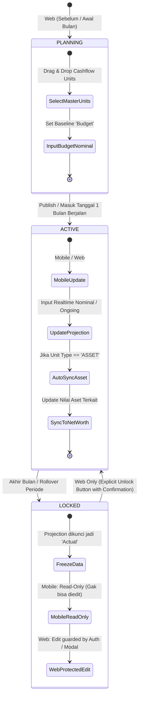
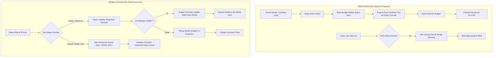
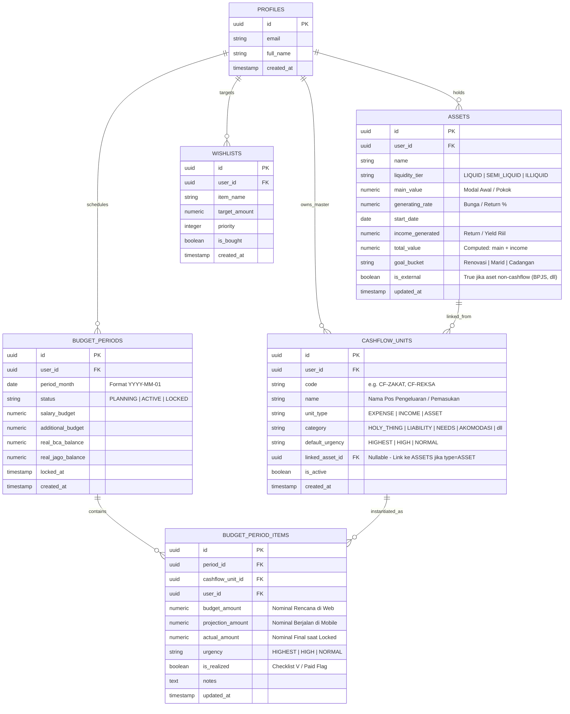

# SYSTEM SPECIFICATION: SELF CASH FLOW & NET WORTH TRACKER (v2.1)

Dokumen arsitektur dan spesifikasi sistem yang telah disesuaikan dengan konsep **Corporate / Personal Finance Planning (Budget - Projection - Actual)**, **Dual-Interface Paradigm (Mobile vs Web)**, **Master Data Driven Architecture**, dan **Spesifikasi Teknis Lengkap pada PRD**.

---

## 1. DUAL-INTERFACE PARADIGM & SYSTEM ARCHITECTURE

Sistem ini memisahkan secara tegas *role & workflow* antara desktop dan mobile:

```
┌────────────────────────────────────────────────────────────────────────┐
│                        WEB APP (DESKTOP CONSOLE)                       │
│  "Planning, Master Data & Financial Governance"                        │
│  • CRUD Master Data (Cashflow Units & Assets)                          │
│  • Drag & Drop Monthly Budget Builder                                  │
│  • Set Baseline 'Budget' Nominal                                       │
│  • Month Locking Governance & Protected 'Unlock Past Month' Override   │
└────────────────────────────────────┬───────────────────────────────────┘
                                     │
                             Shared Database
                      (Supabase PostgreSQL + RLS)
                                     │
┌────────────────────────────────────┴───────────────────────────────────┐
│                        MOBILE APP (PWA / IPHONE)                       │
│  "Field Execution, Daily Updates & Instant Monitoring"                 │
│  • Fast Numeric Input: Update 'Projection' Bulan Berjalan              │
│  • Quick Toggles & Realtime Net Worth Balance Checker                  │
│  • Read-Only Past Months (Immutable Historical 'Actual' Data)          │
│  • Mobile Reporting & Outcome Charts                                   │
└────────────────────────────────────────────────────────────────────────┘
```

---

## 2. FLOWCHART SISTEM

### A. Lifecycle: Budget vs Projection vs Actual & Month State Machine



---

### B. Dual-Interface User Journey (Web vs Mobile)



---

## 3. ENTITY RELATIONSHIP DIAGRAM (ERD)



---

## 4. PRODUCT REQUIREMENT DOCUMENT (PRD v2.1)

### 4.1 Master Data Driven Model
* **PRD-M1 (CRUD Cashflow Unit):** Web App menyediakan antarmuka tabel master untuk menambah, mengubah, mengaktifkan/menonaktifkan Cashflow Unit.
* **PRD-M2 (Asset Linkage):** Setiap Cashflow Unit bertipe `ASSET` wajib ditautkan ke salah satu entitas di tabel `ASSETS`.

### 4.2 Web Console: Drag-and-Drop Budget Builder
* **PRD-W1 (Budget Workspace):** Pengguna dapat melihat daftar master Cashflow Unit di panel samping (sidebar), lalu melakukan *drag-and-drop* ke dalam workspace periode bulanan.
* **PRD-W2 (Baseline Planning):** Input nominal `Budget` untuk setiap item yang ditarik ke dalam periode.
* **PRD-W3 (Governance Unlock):** Riwayat bulan lalu yang berstatus `LOCKED` terkunci secara default. Web menyediakan tombol `Buka Kunci Periode` dengan dialog konfirmasi audit trail untuk mencegah manipulasi data historis secara tidak sengaja.

### 4.3 Mobile PWA: Execution & Projection
* **PRD-MOB1 (Quick Numeric Update):** Pengguna di mobile dapat langsung men-tap baris item untuk mengupdate nominal `Projection` dan toggle status `is_realized` (checklist `V`).
* **PRD-MOB2 (Auto-Sync to Asset):** Ketika item cashflow bertipe `ASSET` di-update nilai projection-nya (atau status di-set terlaksana), sistem secara reaktif mengakumulasikan nilai tersebut ke kolom `total_value` pada aset terkait.
* **PRD-MOB3 (Past Month Read-Only Guard):** Jika pengguna memilih bulan yang sudah lewat (`LOCKED`), antarmuka mobile otomatis mengunci semua input text, toggle, dan tombol delete, menampilkan badge visual *"Arsip Bulan Ini Terkunci (Read-Only)"*.

### 4.4 Net Worth Dashboard ("INI DUIT COK")
Sistem mengelompokkan portofolio ke dalam 4 metrik finansial terstandar:
1. **Total Net Worth** (*"INI DUIT COK"*): Total seluruh aset (Liquid + Semi-Liquid + Illiquid).
2. **Total Aset Likuid** (*"INI YANG CAIR"*): Kas operasional & tabungan instan.
3. **Total Aset Semi-Likuid** (*"INI YANG AGAK CAIR"*): Reksa dana, obligasi/SBN, emas.
4. **Total Aset Ilikuid** (*"INI YANG BEKU"*): BPJS Ketenagakerjaan (SDI & DNA) & instrumen jangka panjang terkunci.

---

### 4.5 SPESIFIKASI TEKNIS (TECHNICAL SPECIFICATIONS)

#### A. Core Application Stack
* **Language & Runtime:** TypeScript (Strict Mode) + Node.js LTS.
* **Frontend Framework:** **Next.js (App Router)**
  * Support hybrid rendering: Static generation untuk shell layout, Server Components untuk data fetching aman, dan Client Components untuk interaktivitas drag-and-drop.
* **Styling Framework:** **Tailwind CSS v3/v4** + CSS Variables untuk color tokens dinamis (Dark/Light mode).
* **UI Component Primitives:** **shadcn/ui** berbasis Radix UI Primitives (Accessible, unstyled, headless, zero lock-in).
* **Icon Set:** **Lucide React** (konsisten, ringan, tree-shakable).
* **Charts & Analytics Engine:** **Recharts** (SVG-based, responsive container, optimal untuk Pie, Donut, dan Bar Chart).
* **Drag and Drop Engine:** **`@dnd-kit/core`** + **`@dnd-kit/sortable`**
  * Alasan teknis: Menggantikan `react-beautiful-dnd` yang sudah *deprecated*. `@dnd-kit` memiliki performa superior, ukuran bundle kecil, native touch sensor support untuk mobile pointer, dan aksesibilitas keyboard lengkap.
* **Form & Validation Management:** **React Hook Form** + **Zod** (Schema validation sinkron antara form frontend dan database constraint).
* **State Management & Server Caching:**
  * Client UI State: **Zustand** (ringan untuk state modal, drawer, dan drag preview).
  * Server State & Cache: **TanStack Query (React Query v5)** / Next.js Server Actions dengan revalidasi tag otomatis (`revalidateTag`, `revalidatePath`).

#### B. Database, Security & Backend Engine ($0 Zero-Cost Infrastructure)
* **Database Provider:** **Supabase (PostgreSQL 15+)**
  * Free Tier Allowance: Database storage 500 MB, MAU 50.000, 500k edge function invocations/bulan (jauh melebihi kebutuhan solo user).
* **Financial Precision Standard:**
  * Semua kolom nominal mata uang wajib bertipe `NUMERIC(15, 2)` pada PostgreSQL. Dilarang keras menggunakan tipe data floating point (`FLOAT` / `DOUBLE`) demi mencegah pembulatan sen liar.
* **Data Security & Multi-Tenant Isolation:**
  * Mengaktifkan **Row-Level Security (RLS)** pada setiap tabel.
  * Policy standar isolasi:
    ```sql
    ALTER TABLE budget_periods ENABLE ROW LEVEL SECURITY;
    CREATE POLICY "User isolates own budget periods"
      ON budget_periods FOR ALL
      USING (auth.uid() = user_id)
      WITH CHECK (auth.uid() = user_id);
    ```
* **Immutability & Lock Enforcement Trigger:**
  * Menjamin di level database bahwa baris data pada periode yang berstatus `LOCKED` tidak dapat diubah oleh sesi non-admin/mobile:
    ```sql
    CREATE OR REPLACE FUNCTION enforce_period_lock_guard()
    RETURNS TRIGGER AS $$
    DECLARE
      period_stat TEXT;
    BEGIN
      SELECT status INTO period_stat FROM budget_periods WHERE id = NEW.period_id;
      IF period_stat = 'LOCKED' AND current_setting('app.admin_override', true) IS NULL THEN
        RAISE EXCEPTION 'Database Guard: Transaksi pada periode LOCKED bersifat immutable.';
      END IF;
      RETURN NEW;
    END;
    $$ LANGUAGE plpgsql;

    CREATE TRIGGER trg_guard_budget_items_lock
      BEFORE UPDATE OR DELETE ON BUDGET_PERIOD_ITEMS
      FOR EACH ROW EXECUTE FUNCTION enforce_period_lock_guard();
    ```
* **Reactive Asset Synchronization (Database Trigger / Function):**
  * Ketika record pada `BUDGET_PERIOD_ITEMS` bertipe unit `ASSET` diubah nilainya (misal `projection_amount` bertambah), trigger Postgres otomatis menghitung dan mengupdate kolom `income_generated` atau `total_value` pada tabel `ASSETS`.

#### C. Mobile PWA & iOS Safari Compliance
* **Web App Manifest (`public/manifest.json`):**
  * `display: "standalone"` (menghilangkan address bar dan toolbar Safari).
  * `orientation: "portrait-primary"`.
  * `theme_color: "#0F172A"` & `background_color: "#0F172A"`.
  * `icons`: 192x192px dan 512x512px (PNG maskable + standard).
* **iOS Specific Head Meta Tags:**
  * `<meta name="apple-mobile-web-app-capable" content="yes" />`
  * `<meta name="apple-mobile-web-app-status-bar-style" content="black-translucent" />`
  * `<link rel="apple-touch-icon" href="/icons/apple-touch-icon.png" />`
* **Service Worker Caching Strategy:**
  * **Static Assets (CSS, JS, Fonts, Shell HTML):** *Stale-While-Revalidate* untuk startup aplikasi instan tanpa loading screen.
  * **Data Transaksi / API:** *Network-First* dengan *IndexedDB Local Fallback* agar user tetap bisa melihat data saat offline/koneksi jelek di perjalanan.
* **Touch Optimization:**
  * Target sentuh minimal $44 \times 44\text{px}$ sesuai Apple Human Interface Guidelines (HIG).
  * CSS property `touch-action: manipulation` untuk mematikan double-tap-to-zoom delay (latensi klik 300ms hilang, terasa native).

#### D. Hosting, CI/CD & Deployment ($0 Cost)
* **Frontend & Edge Hosting:** **Vercel (Hobby Tier)** atau **Cloudflare Pages**
  * Unlimited edge request bandwidth, auto-SSL/HTTPS sertifikat dari Let's Encrypt / DigiCert.
  * Direct Git integration (Push ke branch `main` langsung trigger auto-build & edge deployment dalam $< 60$ detik).

---

## 5. DESIGN SYSTEM & UI WORKFLOW

### A. Web Console Layout (Desktop-First)
* **Left Sidebar:** Master Data Navigation (Cashflow Units Master, Asset Master, Settings).
* **Center Stage (Budget Builder):**
  * Mode Grid / Kanban Board per Kategori (`Holy Thing`, `Liability`, `Needs`, dll).
  * Kartu unit bisa di-drag antar kategori atau dari drawer master data.
  * Input field `Budget (IDR)` dengan mask otomatis (misal `Rp 1.000.000`).
* **Top Bar Action:** Selector Periode (`2026-11`), Status Badge (`PLANNING` / `ACTIVE` / `LOCKED`), dan tombol `Unlock / Edit Closed Month`.

### B. Mobile PWA Layout (Thumb-Friendly iOS UX)
* **Top Header:** Carousel 4 Kartu Likuiditas (*Ini Duit Cok*, *Cair*, *Agak Cair*, *Beku*).
* **Sub-Header:** Tab Switcher `Projection View` vs `Outcome Chart`.
* **Transaction Row Component:**
  * Sisi kiri: Icon Kategori + Nama Unit + Badge Urgency (`HIGHEST`, `HIGH`, `NORMAL`).
  * Sisi kanan: Tombol Checklist `V` besar + Nominal `Projection` yang dapat di-tap untuk membuka keyboard angka instan.
  * Visual feedback: Jika `is_realized = true`, background baris berubah menjadi aksen hijau lembut.
* **Locked State Visual:** Saat melihat bulan yang `LOCKED`, seluruh row memiliki opacity 75%, icon gembok di sudut kanan atas, dan input field berstatus `disabled`.
